# Bakgrunnsanimasjon — Prosjektkontekst

## Hva dette er

`index.html` er en selvstendig HTML-fil (ingen dependencies, ingen server nødvendig — bare åpne i nettleser) som fungerer som en animert bakgrunn for en 1920×1080 skjerm.

SVG-illustrasjonene er flyttet ut til separate filer i `svg/`-mappen og kan legges tilbake senere.

## Visuell struktur

### `index.html` — kun CSS-bakgrunn

Tre store, mykt utskarpe sirkler (`filter: blur(120px)`) med røde/blå `radial-gradient` mot en lilla bakgrunn (`#400EA1`). Orbene beveger seg sakte og organisk via CSS `@keyframes` animasjoner med ulike varigheter (12s, 15s, 18s) og store translasjonsverdier (±12–25vw/vh) for å skape en levende, ikke-repetitiv bevegelse.

### `svg/` — ekstraherte illustrasjonslag

Hver fil er en standalone SVG med `viewBox="0 0 1920 1080"`. Alle elementer er hvite (`fill="white"` / `stroke="white"`).

| Fil | Innhold | Posisjonering |
|-----|---------|---------------|
| `bekkband-navn-og-ottar.svg` | Hovedillustrasjon: stilisert ottar med øyne, tentakler, hår og dekorative elementer | Direkte 1920×1080 |
| `live.svg` | «Live»-tekst/illustrasjon | `translate(264, 631)` |
| `poweredby-logo.svg` | «poweredby»-logo | `translate(1629, 934)` |

## Fargepalett
- Bakgrunn: `#400EA1` (lilla)
- Orb-gradienter: `#fe3d3d` (rød) → `#0c00bb` (dyp blå)
- Alle illustrasjoner/logoer: `#ffffff` (hvit)

## Legge tilbake SVG-lag

Når lagene skal tilbake i `index.html`, kan de importeres via en overlay-container med f.eks.:

```css
.overlay {
  position: fixed;
  inset: 0;
  display: flex;
  align-items: center;
  justify-content: center;
  pointer-events: none;
}
.overlay img {
  width: 100vw;
  height: 100vh;
  max-width: calc(100vh * 16 / 9);
  max-height: calc(100vw * 9 / 16);
}
```

```html
<div class="overlay">
  
  <!-- flere lag etter behov -->
</div>
```

## Tekniske detaljer
- Ren HTML/CSS, ingen JavaScript, ingen tredjepartsbiblioteker
- `index.html` = kun animert bakgrunn (~94 linjer)
- SVG-filer er standalone med inline paths
- Fungerer lokalt uten server
